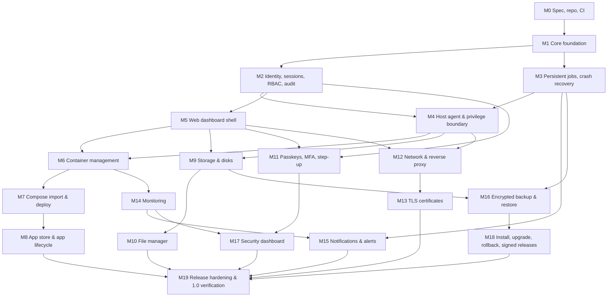

# Kernhaven Milestones

Each milestone ends with the milestone gate (G2) from
[Quality Gates](../release/QUALITY-GATES.md). A milestone design document
(`Mx-<name>.md`) with architecture and acceptance criteria is written and
committed **before** implementation starts.

## Dependency graph

## Milestone list

| MS | Name | Depends on | Features (matrix) | Status |
|---|---|---|---|---|
| M0 | Specification, repository, CI | — | Docs, CI | Done |
| M1 | Core foundation | M0 | AT-F00-01..06 | Done — [design and evidence](M1-core-foundation.md) |
| M2 | Identity, sessions, RBAC, audit log | M1 | F08 (01–04, 06), F09-01, F10 (01–02) | Implemented on branch `m2-identity`, CI green, owner review pending — [design](M2-identity.md) |
| M3 | Persistent jobs and crash recovery | M1 | F18 (01, 02, 04) | Implemented on branch `m3-jobs` (based on `m2-identity`), CI green, owner review pending — [design](M3-jobs.md) |
| M4 | Host agent and privilege boundary | M2, M3 | TH-20..24 | Implemented on branch `m4-agent` (based on `m5-dashboard`), CI green, owner review pending — [design](M4-agent.md) |
| M5 | Web dashboard shell | M2 | F01 (01–04), F08-05, F18-03 | Implemented on branch `m5-dashboard` (based on `m3-jobs`), CI green, owner review pending — [design](M5-dashboard.md) |
| M6 | Container management | M4, M5 | F02, F01-05 | Implemented on branch `m6-containers` (F02-01..06), CI green, owner review pending — [design](M6-containers.md) |
| M6b | Streaming: exec console, live events, log follow | M6 | F02-07, F01-05 | Not started |
| M7 | Compose import, validation, deploy | M6 | F03 | Done on branch `m7-compose` (based on `m6-containers`), CI 40565761279; merge pending owner review — [design](M7-compose.md) |
| M8 | App store and app lifecycle | M7 | F04, F05 | Done on branch `m8-apps` (based on `m7-compose`), CI 40574613677, merge pending owner review; reverse proxy route of AT-F05-01 added in M12 (`m12-network`) — [design](M8-apps.md) |
| M9 | Storage and disk management | M4, M5 | F06 (01–03) | Done on branch `m9-storage` (based on `m8-apps`), CI 40601258272, merge pending owner review — [design](M9-storage.md) |
| M10 | File manager | M9 | F07 | Done on branch `m10-files` (based on `m9-storage`), CI 40701148605, merge pending owner review — [design](M10-files.md) |
| M11 | Passkeys, MFA, step-up auth | M2, M5 | F09 (02–05) | Done on branch `m11-mfa` (based on `m10-files`), CI 40719877647, merge pending owner review — [design](M11-mfa.md) |
| M12 | Network and reverse proxy | M4, M5 | F11 | Done on branch `m12-network` (based on `m11-mfa`), CI 40761331938, merge pending owner review — [design](M12-network.md) |
| M13 | TLS certificate management | M12 | F12 (01–03) | Not started |
| M14 | System and container monitoring | M6 | F13 | Not started |
| M15 | Notifications and alerts | M3, M14 | F16, F06-04, F12-04 | Not started |
| M16 | Encrypted backup and restore | M3, M9 | F14 | Not started |
| M17 | Security dashboard | M11, M14 | F10 (03–04) | Not started |
| M18 | Installer, upgrades, rollback, signed releases | M16 | F15, F17 | Not started |
| M19 | Release hardening and 1.0 verification | all | Release gate G4 | Not started |

## Known blockers

| ID | Blocker | Blocks | Needs |
|---|---|---|---|
| B-1 | Resolved 2026-10-27: Docker 29.9.2 rootless for `dev01` on `khv01-dev` | — | — |
| B-2 | No Debian 13 integration VMs (amd64, arm64) exist | Integration acceptance for M4+ and every release gate | Provisioned Debian 13 VMs reachable from CI or the dev server |
| B-3 | Release signing key ceremony not defined | M18 | Decision on ADR-0013 |
